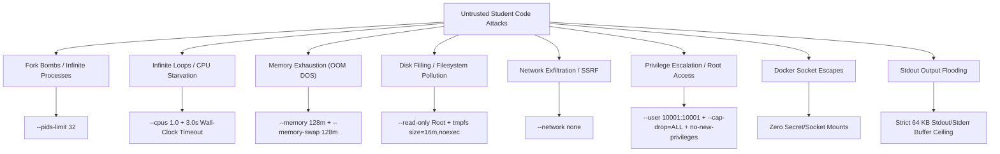
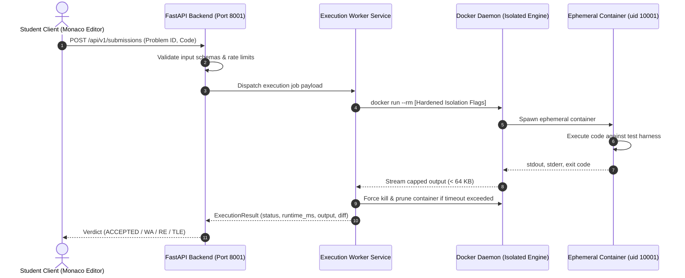

# CodeRazz — Phase 3 Secure Execution Sandbox Architecture & Design Specification

**Document Version:** 1.0.0  
**Status:** Approved Architecture Design (Implementation Deferred to Phase 3)  
**Budget Policy:** 100% Free & Open-Source (FOSS) — Zero paid tools, local Docker container sandboxing  
**Target Runtime:** Linux Alpine / Debian Slim isolated execution runner  

---

## 1. Core Mission & Threat Model

In **Phase 3 (Student Coding Platform & Secure Execution Sandbox)**, CodeRazz will accept arbitrary, unvetted Python code written by students and execute it against test cases to generate outputs, error traces, and execution telemetry for misconception diagnosis.

```
+--------------------------------------------------------------------------------+
|                             CRITICAL SECURITY AXIOM                            |
|                                                                                |
|                 STUDENT CODE IS STRICTLY AND PERMANENTLY UNTRUSTED.            |
|       Under no circumstances shall student code execute within the primary      |
|       FastAPI web application process, on the bare host system, or with access  |
|               to network interfaces, application secrets, or Docker sockets.   |
+--------------------------------------------------------------------------------+
```

### The Untrusted Code Threat Landscape



---

## 2. Multi-Layer Defense-in-Depth Architecture

The CodeRazz execution engine employs a 4-layer isolation model separating the client browser, API orchestrator, execution worker, and container runtime:



---

## 3. Ephemeral Container Specifications & Runtime Directives

Every student code submission runs in a **disposable, brand-new container instance** created on demand and destroyed immediately upon termination.

### A. The Master Docker Invocation Contract
```bash
docker run \
  --name coderazz-exec-${SUBMISSION_UUID} \
  --rm \
  --network none \
  --read-only \
  --tmpfs /tmp:rw,noexec,nosuid,nodev,size=16m \
  --user 10001:10001 \
  --cap-drop=ALL \
  --security-opt=no-new-privileges \
  --pids-limit 32 \
  --cpus 1.0 \
  --memory 128m \
  --memory-swap 128m \
  --env PYTHONUNBUFFERED=1 \
  --env PYTHONDONTWRITEBYTECODE=1 \
  --volume ${RUNNER_DIR}/harness.py:/app/harness.py:ro \
  --volume ${SUBMISSION_FILE}:/app/solution.py:ro \
  coderazz-python-runner:latest \
  python3 /app/harness.py
```

### B. Flag-by-Flag Security Breakdown

| Flag / Parameter | Value | Security Guarantee & Threat Mitigation |
|---|---|---|
| `--rm` | Enabled | Guarantees automatic removal of the container filesystem metadata upon exit. |
| `--network` | `none` | **Total network severance.** Eliminates socket creation, network exfiltration, port scanning, and SSRF attacks. |
| `--read-only` | Enabled | Root container filesystem is strictly read-only. Blocks writing malicious binaries, modifying system packages, or writing startup hooks. |
| `--tmpfs /tmp` | `rw,noexec,nosuid,nodev,size=16m` | In-memory temporary directory capped at 16 MB. `noexec` blocks executing downloaded or generated binaries. Discarded automatically on exit. |
| `--user` | `10001:10001` | Non-root execution. Even in the event of an interpreter vulnerability, execution has zero root privileges. |
| `--cap-drop` | `ALL` | Strips all Linux capabilities (e.g., `CAP_NET_ADMIN`, `CAP_SYS_ADMIN`, `CAP_SYS_PTRACE`, `CAP_CHOWN`). |
| `--security-opt` | `no-new-privileges` | Blocks processes from gaining additional privileges via `setuid` or `setgid` binaries. |
| `--pids-limit` | `32` | Hard process ceiling. Instantly neutralizes fork bombs (e.g. `while True: os.fork()`) by terminating child process creation once 32 PIDs are reached. |
| `--cpus` | `1.0` | Maximum 1 physical CPU core quota (`--cpu-quota=100000`). Prevents infinite loops from starving host system resources. |
| `--memory` | `128m` | Hard memory ceiling. Prevents memory leaks and runaway list allocations from triggering host Out-Of-Memory (OOM) killer. |
| `--memory-swap` | `128m` | Swap ceiling equal to memory ceiling. Blocks swap thrashing and disk thrashing attacks. |

---

## 4. Execution Timeouts & Dual-Layer Reaping

Infinite loops (e.g., `while True: pass`) cannot be trusted to self-terminate. CodeRazz enforces a **dual-layer timeout architecture**:

1. **Layer 1: Wall-Clock Asyncio Watchdog (Application Level)**
   - The execution worker wraps the container invocation in `asyncio.wait_for(..., timeout=3.0)`.
   - If the container does not terminate within **3.0 seconds**, the watchdog raises `asyncio.TimeoutError`.
2. **Layer 2: Forceful Container Termination (Docker Level)**
   - Upon timeout expiration, the worker immediately issues `docker kill coderazz-exec-${SUBMISSION_UUID}`.
   - The worker records verdict `TIME_LIMIT_EXCEEDED (TLE)` with `runtime_ms = 3000`.
3. **Layer 3: Background Orphan Container Reaper**
   - A lightweight recurring asyncio background task queries Docker for any containers with label `coderazz.sandbox=true` whose creation timestamp exceeds 10 seconds, forcefully killing and removing any orphaned containers.

---

## 5. Secret Isolation & Docker Socket Protection

```
+--------------------------------------------------------------------------------+
|                         ABSOLUTE ISOLATION BOUNDARIES                          |
|                                                                                |
|  1. Under NO circumstances shall /var/run/docker.sock be mounted inside any    |
|     execution container or made accessible to student code.                    |
|  2. Under NO circumstances shall application .env files, database passwords,   |
|     JWT secret keys, or host source directories be mounted.                   |
|  3. Student code files (solution.py) are written to an isolated ephemeral      |
|     directory with restrictive permissions (0600) and mounted read-only (:ro). |
+--------------------------------------------------------------------------------+
```

---

## 6. Safe I/O Handling & Output Buffer Ceilings

A common denial-of-service vector against online judges is **stdout flooding** (e.g., `while True: print("A" * 1000)`). Unchecked output buffering can exhaust web server memory or crash database serialization.

### Output Sanitization Policy
1. **Buffer Ceiling:** Output capture streams (`stdout` and `stderr`) are capped at **64 KB** (`SANDBOX_MAX_OUTPUT_BYTES = 65536`).
2. **Truncation Behavior:** If student output exceeds 64 KB, output reading is terminated immediately, a `[OUTPUT TRUNCATED - SIZE EXCEEDED 64 KB]` marker is appended, and the execution is flagged.
3. **Unicode Normalization:** All captured bytes are decoded with `errors="replace"` to prevent invalid UTF-8 sequences from causing JSON serialization exceptions.

---

## 7. Process Separation from FastAPI Application

To ensure high availability and responsiveness of the web platform:

1. **Zero Host Execution in Production:** Student code is **never** executed via Python `exec()`, `eval()`, or bare host subprocesses in production.
2. **Decoupled Worker Queue:** Submissions are dispatched to dedicated worker coroutines using an asynchronous queue (`asyncio.Queue` in local mode; Redis/RabbitMQ ready for scaling).
3. **Independent Event Loops:** Container monitoring occurs outside the main FastAPI request-handling thread pool.

---

## 8. Host Subprocess Fallback Boundary (Development Smoke Tests Only)

If Docker Desktop is offline during local developer iteration:
- The host subprocess fallback runner is **strictly restricted to verified developer smoke tests** (pre-approved test programs authored by developers).
- It is **explicitly disabled for untrusted student submissions** and returns HTTP 503 (`Docker sandbox runner is required for untrusted submissions`).
- Developers cannot bypass this safety check without setting `ALLOW_UNSAFE_HOST_EXECUTION=true`, which emits prominent console warning alerts.

---

## 9. Future Production Virtualization Roadmap (Kernel Isolation)

For multi-tenant public cloud deployment where untrusted code from arbitrary internet users is accepted:
1. **gVisor (`runsc`):** Google's application kernel providing defense against Linux kernel exploits by intercepting system calls in user space (`--runtime=runsc`).
2. **Firecracker MicroVMs:** Amazon's lightweight microVM technology providing full hardware virtualization boundaries with sub-second boot times.

---

## 10. Phase 3 Implementation Readiness Checklist

When Phase 3 is officially authorized, implementation will proceed according to this verified specification:

- [ ] Create `execution/docker/Dockerfile.sandbox` (Python 3.12 Alpine, non-root user `uid=10001`).
- [ ] Implement `execution/harness.py` (Isolated test case runner loading `solution.py`).
- [ ] Implement `execution/runner.py` (Docker CLI / Docker SDK container manager enforcing all security flags).
- [ ] Implement dual-layer timeout watchdog and container reaper.
- [ ] Create problem library seed datasets with sample and hidden test cases.
- [ ] Integrate Monaco Editor in Next.js frontend with live submission execution and output diff viewer.
