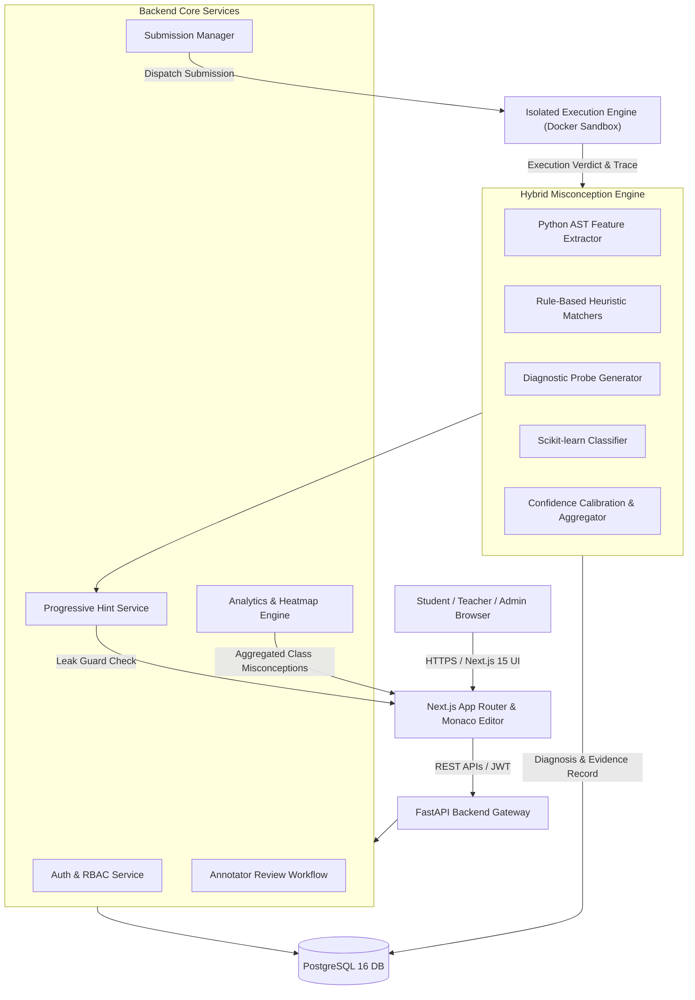
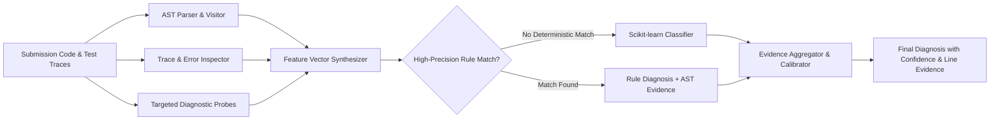
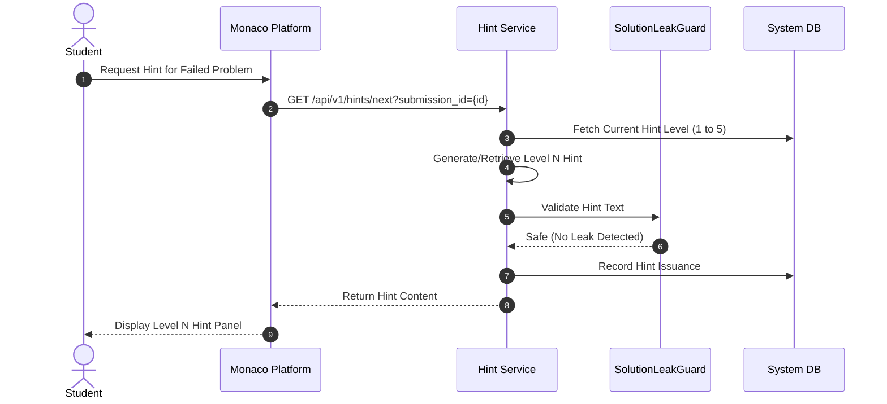
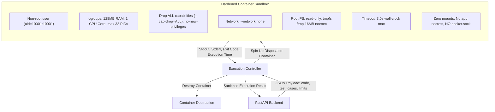
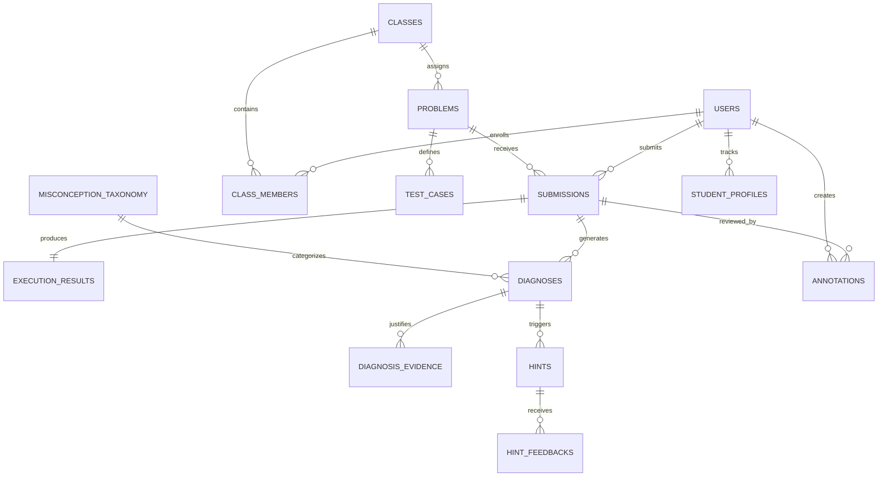

# CodeRazz — System Architecture & Technical Specification

> **Version:** 1.0.0-draft  
> **Status:** Phase 0 Architecture Proposal  
> **Author:** CodeRazz Engineering Team  
> **Cost Model:** ₹0 (100% Free & Open-Source Software)

---

## 1. System Overview & Core Philosophy

**CodeRazz** is an intelligent, misconception-aware programming tutor designed for introductory computer science education. Traditional online judges (LeetCode, HackerRank, standard grading systems) operate as black-box verifiers: they output binary outcomes (*Accepted*, *Wrong Answer*, *Runtime Error*, *Time Limit Exceeded*). For novice learners, these verdicts fail to elucidate the underlying mental model errors causing the bug.

CodeRazz addresses this pedagogical gap through a **hybrid diagnostic pipeline** that combines:
1. **Abstract Syntax Tree (AST) structural static analysis.**
2. **Behavioral error signatures and dynamic trace inspection.**
3. **Targeted diagnostic probing (synthetic test mutation).**
4. **Scikit-learn multi-label classification trained on program vector representations.**
5. **Calibrated evidence-based confidence scoring.**
6. **A 5-level progressive hint ladder with automated solution-leak guards.**
7. **Class-level diagnostic analytics for educators.**

---

## 2. Authoritative Misconception Taxonomy (30 Core Classes + 2 Meta-Classes)

> **Taxonomy Discrepancy Note & Specification Alignment:**  
> While introductory literature and early planning documents loosely reference a "27-misconception taxonomy", a rigorous summation of the canonical categories A through G yields exactly **30 authoritative core misconception classes** (A: 5, B: 5, C: 5, D: 5, E: 4, F: 3, G: 3 = 30), plus **2 separately documented meta-classes** (`S1` and `S2`), totaling **32 distinct classification targets**.  
> In strict accordance with our engineering and pedagogical contracts, **no category is arbitrarily deleted, merged, or renamed**. All 30 core classes and 2 meta-classes are preserved as authoritative.

| Category | Code | Misconception Name | Formal Description |
|---|---|---|---|
| **A: Loops & Indexing** (5) | `A1` | Off-by-one in loop bounds | Range end-bound misunderstanding (e.g., `range(len(arr))` vs `range(len(arr) - 1)` or inclusive boundary errors). |
| | `A2` | Infinite loop condition | While-loop predicate never mutates toward termination condition. |
| | `A3` | Index out of range | Accessing index `i >= len(sequence)` due to incorrect boundary assumption. |
| | `A4` | Inner loop variable shadowing / update | Reusing the outer loop variable in an inner loop or updating the wrong iterator variable. |
| | `A5` | Premature loop termination | Misplaced `return` or `break` inside loop body on first iteration instead of after exhaustion. |
| **B: Conditions & Logic** (5) | `B1` | Assignment instead of equality | Using `=` where `==` was intended (or assignment side-effects in conditional logic). |
| | `B2` | Inverted or incorrect boolean operators | Misusing `and` instead of `or`, or inverted inequality operators (`<` vs `>`). |
| | `B3` | Overlapping or misplaced elif branches | Placing more general condition before specific condition, rendering branches unreachable. |
| | `B4` | Indentation / dangling branch | Incorrect indentation causing code to execute outside conditional guard. |
| | `B5` | Redundant / contradictory predicates | Testing conditions that are impossible or already proven true by preceding guards. |
| **C: Scope & State** (5) | `C1` | Uninitialized variable usage | Referencing identifier before first assignment in path. |
| | `C2` | Variable shadowing & local/global confusion | Accidentally shadowing outer scope variables or expecting local mutation to persist globally. |
| | `C3` | Unintended mutable object alias mutation | Mutating default argument list/dict or modifying aliased list references unintentionally. |
| | `C4` | Type mismatch in operations | Attempting string + integer concatenation or invalid implicit type assumptions. |
| | `C5` | Loop variable rebinding | Explicitly assigning to the loop iterator variable inside the loop expecting it to persist. |
| **D: Functions & Recursion** (5) | `D1` | Missing recursive base case | Recursion continues indefinitely without termination condition. |
| | `D2` | Missing or implicit `None` return | Function computes value but fails to execute an explicit `return`. |
| | `D3` | Argument count or order inversion | Calling function with swapped or incorrect number of parameters. |
| | `D4` | Return inside loop instead of post-loop | Returning accumulated result inside the first iteration of accumulator loop. |
| | `D5` | Recursive call without argument reduction | Calling recursive step with identical parameters, inducing maximum recursion depth error. |
| **E: Data Structures** (4) | `E1` | Modifying collection during iteration | Adding or deleting items from a list while looping over it. |
| | `E2` | Unchecked dictionary key access | Accessing `d[k]` without verification or `.get()` fallback. |
| | `E3` | Shallow vs Deep copy confusion | Mutating nested lists believing a `.copy()` or slice produced an independent clone. |
| | `E4` | Non-subscriptable object indexing | Applying `[idx]` to integers, floats, or non-iterable objects. |
| **F: Algorithms & Efficiency** (3)| `F1` | Premature accumulator reset | Re-initializing counter or accumulator inside the loop body on every iteration. |
| | `F2` | Inefficient quadratic lookup | Using `item in list` inside a loop instead of set/hash lookup leading to TLE. |
| | `F3` | Unstable sort assumption | Expecting relative order preserved without understanding sorting stability. |
| **G: I/O & Language Idioms** (3) | `G1` | Confusing `print()` with `return` | Printing the answer inside a function instead of returning it to the caller. |
| | `G2` | Unparsed input data types | Using `input()` directly as numeric operand without `int()` / `float()` conversion. |
| | `G3` | In-place string mutation attempt | Attempting `s[0] = 'a'` on immutable Python strings. |
| **Meta-Classes** (2) | `S1` | Careless slip / Syntax typo | Syntactic misspelling, mismatched parenthesis, or minor formatting slip. |
| | `S2` | Novel / Unclassified pattern | Genuine logic error with low confidence across known taxonomy classes. |

---

## 3. Hybrid Diagnostic Engine Architecture

### 3.1 Static AST Feature Extraction
- Built using Python's native `ast` library.
- Extracts AST node patterns:
  - Loop boundary constructs (`ast.For`, `ast.While`, `ast.Call` with `range`).
  - Return statement positions relative to parent loop bodies.
  - Variable reference timelines vs assignments.
  - Mutable default argument definitions.
  - In-place mutation calls (`list.append`, `list.remove`) inside `ast.For` target scopes.

### 3.2 Dynamic Diagnostic Probing
- When standard test cases fail with ambiguous signatures, the Diagnostic Probe Engine feeds targeted micro-inputs:
  - *Empty input / single element:* Probes for `A1`, `A3`, `D1`.
  - *Identical input repeatedly:* Probes for `C3` (mutable default state accumulation).
  - *Monotonically increasing vs decreasing:* Probes for `B2`, `B3`.
- Probe signatures confirm or reject heuristic hypotheses.

### 3.3 Scikit-learn Classifier & Confidence Thresholding

- **Model:** Calibrated Ensemble (Logistic Regression with TF-IDF token n-grams + RandomForest on engineered AST features).
- **Output:** Probability distribution across the authoritative taxonomy classes.
- **Configurable Diagnostic Thresholds (Subject to Empirical Calibration):**
  > [!IMPORTANT]
  > The values $0.70$ and $0.40$ below represent **initial configurable heuristic thresholds** rather than empirically calibrated ground truth. True calibration requires testing against validated, human-annotated student datasets.
  - *Automated High-Confidence Hypothesis ($\ge 0.70$ default):* Accepted as automated primary diagnosis.
  - *Candidate Hypotheses ($0.40 - 0.69$ default):* Flagged with lower confidence; top 2 candidates surfaced.
  - *Novel / Low Confidence ($< 0.40$ default):* Classified as `S2` (Novel/Unclassified) and routed to the human annotator queue.
- **Rule-First Priority:** Deterministic AST visitors and behavioural probe signatures take precedence over statistical ML predictions in initial phases. The ML pipeline is modular and intended to activate progressively as benchmark training data is accumulated.

---

## 4. Five-Level Progressive Hint Ladder & Solution Leak Guard

To foster genuine cognitive development without degrading problem rigor, CodeRazz enforces a 5-tier progressive hint ladder.

### 4.1 The 5 Hint Levels

1. **Level 1 — Nudge:**
   *Focus:* Guides the student's attention to where the discrepancy occurs.
   *Example:* *"Look closely at what happens on the very first or very last repetition of your loop."*
2. **Level 2 — Conceptual Explanation:**
   *Focus:* Teaches the underlying computational concept in abstract terms.
   *Example:* *"In Python, `range(start, stop)` generates numbers up to `stop - 1`. It does not include `stop` itself."*
3. **Level 3 — Counter-Example:**
   *Focus:* Provides a concrete minimal test input that exposes the failure.
   *Example:* *"Try tracing your function by hand with the input `nums = [10]`. What does your code output versus the expected value?"*
4. **Level 4 — Worked Analogue:**
   *Focus:* Solves a parallel, isomorphic problem illustrating the correct conceptual pattern.
   *Example:* *"Here is how a similar pattern works when counting occurrences in a shopping list..."*
5. **Level 5 — Targeted Pointer:**
   *Focus:* Pinpoints the specific code line or construct that contains the bug, without rewriting it for them.
   *Example:* *"On line 7, your `return` statement is indented inside the `for` loop body, causing the function to stop after processing only the first element."*

### 4.2 SolutionLeakGuard Protection Engine
Before any hint is returned:
1. **Token Overlap Check:** Computes n-gram intersection between hint text and the reference solution AST/source code.
2. **Regex Filter:** Rejects hints containing complete assignment expressions, return expressions, or syntax blocks that match canonical solution blocks.
3. **Fallback:** If a dynamically generated hint fails verification, the engine automatically falls back to pre-certified, human-curated static templates for that specific misconception.

---

## 5. Sandboxed Code Execution Security Architecture

Student submitted code is inherently untrusted. Execution is strictly partitioned from the main FastAPI server.

### 5.1 Strict Sandbox Security Invariants:
1. **Network Severance:** `--network none` — Absolutely zero egress/ingress network access.
2. **Read-Only Root Filesystem:** `--read-only` prevents writing to any system binaries or paths.
3. **No-Exec Temporary Storage:** `--tmpfs /tmp:rw,noexec,nosuid,size=16m` provides minimal temporary working space; execution of binaries from `/tmp` is blocked by kernel `noexec`.
4. **Unprivileged Execution:** `--user 10001:10001` ensures process runs as a non-root, unprivileged user.
5. **Dropped Linux Capabilities:** `--cap-drop=ALL` strips all POSIX capabilities (e.g., `CAP_NET_ADMIN`, `CAP_SYS_ADMIN`, `CAP_SETUID`).
6. **No Privilege Escalation:** `--security-opt=no-new-privileges` prevents `setuid` binaries from elevating rights.
7. **Process Ceiling (Fork-Bomb Defense):** `--pids-limit 32` caps maximum threads/subprocesses to prevent PID exhaustion.
8. **Resource Caps:** Hard limits of 1 CPU core (`--cpus 1.0`) and 128 MB RAM (`--memory 128m`).
9. **Wall-Clock Termination:** Strict 3.0s wall-clock execution limit with container `kill` on expiry.
10. **Zero Secret Mounting:** Application environment files, secrets, database credentials, and the host Docker socket (`docker.sock`) are **never mounted** into student execution containers.

> [!CAUTION]
> **Host Subprocess Fallback Boundary Warning:**  
> A host subprocess runner (with resource limits and AST pre-screening) **does NOT provide a secure boundary for untrusted code** and can be bypassed by sophisticated payloads. Therefore, any host subprocess execution is **strictly restricted to trusted local development smoke tests**. Untrusted student code must **never** be executed via the host subprocess runner or within the main FastAPI process.

### 5.2 Public Deployment Hardening Roadmap:
Prior to accepting arbitrary public internet submissions, container isolation must be upgraded to kernel-gated runtimes such as:
- **gVisor (`runsc` runtime):** Intercepts and virtualizes all Linux system calls in userspace.
- **Firecracker microVMs:** Provides lightweight, dedicated hardware virtualization per submission.

---

## 6. Complete Database Schema (Entity-Relationship Design)

> **Database Architecture Strategy:**  
> **PostgreSQL 16** is the authoritative production and target database. All relational integrity, foreign key cascading, JSONB analytics indexes, and migrations are designed for PostgreSQL.  
> **SQLite (via aiosqlite)** is supported solely as a local development convenience when the Docker daemon is offline during early development. All migrations and database behaviors must be validated against PostgreSQL before declaring system readiness.

The database schema utilizes PostgreSQL with strong relational integrity, foreign key cascading rules, UUID primary keys, and specialized indexing for high-frequency analytical queries.

### Table Definitions & Primary Columns:
1. `users`: `id (UUID)`, `email (VARCHAR)`, `hashed_password (VARCHAR)`, `full_name (VARCHAR)`, `role (ENUM: student, teacher, annotator, admin)`, `created_at`, `is_active`.
2. `classes`: `id (UUID)`, `name (VARCHAR)`, `join_code (VARCHAR UNIQUE)`, `teacher_id (FK -> users.id)`, `created_at`.
3. `class_members`: `id (UUID)`, `class_id (FK -> classes.id)`, `student_id (FK -> users.id)`, `enrolled_at`.
4. `problems`: `id (UUID)`, `title (VARCHAR)`, `slug (VARCHAR UNIQUE)`, `description_markdown (TEXT)`, `difficulty (ENUM: easy, medium, hard)`, `starter_code (TEXT)`, `canonical_solution (TEXT)`, `created_by (FK -> users.id)`, `is_published (BOOLEAN)`.
5. `test_cases`: `id (UUID)`, `problem_id (FK -> problems.id)`, `input_data (TEXT)`, `expected_output (TEXT)`, `is_sample (BOOLEAN)`, `is_hidden (BOOLEAN)`, `is_probe (BOOLEAN)`.
6. `submissions`: `id (UUID)`, `user_id (FK -> users.id)`, `problem_id (FK -> problems.id)`, `code (TEXT)`, `language (VARCHAR)`, `status (ENUM: pending, running, completed, error)`, `verdict (ENUM: accepted, wrong_answer, runtime_error, time_limit_exceeded, compile_error)`, `submitted_at`.
7. `execution_results`: `id (UUID)`, `submission_id (FK -> submissions.id UNIQUE)`, `total_tests (INT)`, `passed_tests (INT)`, `stdout (TEXT)`, `stderr (TEXT)`, `execution_time_ms (FLOAT)`, `memory_used_kb (INT)`.
8. `misconception_taxonomy`: `code (VARCHAR PRIMARY KEY)`, `category (VARCHAR)`, `name (VARCHAR)`, `description (TEXT)`, `pedagogical_remedy (TEXT)`.
9. `diagnoses`: `id (UUID)`, `submission_id (FK -> submissions.id)`, `misconception_code (FK -> misconception_taxonomy.code)`, `confidence_score (FLOAT)`, `detector_type (ENUM: rule_ast, probe, ml_classifier, human_override)`, `is_primary (BOOLEAN)`, `created_at`.
10. `diagnosis_evidence`: `id (UUID)`, `diagnosis_id (FK -> diagnoses.id)`, `evidence_type (VARCHAR)`, `line_number (INT)`, `code_snippet (TEXT)`, `explanation (TEXT)`.
11. `hints`: `id (UUID)`, `diagnosis_id (FK -> diagnoses.id)`, `user_id (FK -> users.id)`, `level (INT: 1-5)`, `hint_type (VARCHAR)`, `content (TEXT)`, `leak_checked (BOOLEAN)`, `requested_at`.
12. `hint_feedbacks`: `id (UUID)`, `hint_id (FK -> hints.id)`, `is_helpful (BOOLEAN)`, `student_comment (TEXT)`, `created_at`.
13. `annotations`: `id (UUID)`, `submission_id (FK -> submissions.id)`, `annotator_id (FK -> users.id)`, `assigned_misconception_code (FK -> misconception_taxonomy.code)`, `notes (TEXT)`, `agreement_flag (BOOLEAN)`, `created_at`.
14. `student_misconception_profiles`: `id (UUID)`, `student_id (FK -> users.id)`, `misconception_code (FK -> misconception_taxonomy.code)`, `frequency_count (INT)`, `last_observed_at`, `mastery_status (ENUM: persistent, improving, resolved)`.
15. `audit_logs`: `id (UUID)`, `user_id (FK -> users.id)`, `action (VARCHAR)`, `entity_type (VARCHAR)`, `entity_id (VARCHAR)`, `ip_address (VARCHAR)`, `created_at`.

---

## 7. RESTful API Specification (FastAPI Endpoints)

### 7.1 Authentication & User Management
- `POST /api/v1/auth/register` — Register student or teacher account.
- `POST /api/v1/auth/login` — Authenticate and receive JWT access token.
- `GET /api/v1/auth/me` — Retrieve active user profile and role capabilities.
- `GET /api/v1/users` (Admin) — List and manage users.

### 7.2 Problem Library & Test Cases
- `GET /api/v1/problems` — List accessible programming problems with tags and difficulties.
- `GET /api/v1/problems/{slug}` — Retrieve problem description, constraints, and starter code.
- `POST /api/v1/problems` (Teacher/Admin) — Author new problem with sample and hidden test cases.
- `PUT /api/v1/problems/{id}` (Teacher/Admin) — Update problem details.

### 7.3 Submission, Execution & Diagnosis
- `POST /api/v1/submissions` — Submit code for evaluation (dispatches to sandbox).
- `GET /api/v1/submissions/{id}` — Get submission status, test results, and primary diagnosis.
- `GET /api/v1/submissions/my` — Get user's submission history.

### 7.4 Progressive Hint Engine
- `GET /api/v1/hints/submission/{submission_id}` — Get current hint ladder state and unlocked hints.
- `POST /api/v1/hints/request` — Request next hint level (triggers leak guard and template engine).
- `POST /api/v1/hints/{hint_id}/feedback` — Record student rating (helpful / not helpful).

### 7.5 Teacher Analytics & Class Management
- `POST /api/v1/classes` — Create a new class section.
- `POST /api/v1/classes/join` — Join a class using class code.
- `GET /api/v1/classes/{class_id}/analytics/misconceptions` — Class-wide misconception frequency heatmap.
- `GET /api/v1/classes/{class_id}/analytics/trends` — Weekly misconception progress over time.
- `GET /api/v1/classes/{class_id}/students/{student_id}` — Individual student misconception profile.

### 7.6 Human Review & Annotation
- `GET /api/v1/annotations/queue` — Queue of unclassified or low-confidence submissions.
- `POST /api/v1/annotations` — Submit ground-truth label and notes.
- `PUT /api/v1/diagnoses/{id}/override` (Teacher/Annotator) — Correct an automated diagnosis.

---

## 8. Role-Based Access Control (RBAC) Matrix

| Feature / Endpoint | Student | Teacher | Annotator | Admin |
|---|:---:|:---:|:---:|:---:|
| Browse Problems & Submit Code | **Yes** | **Yes** | **Yes** | **Yes** |
| Receive Diagnoses & Request Hints | **Yes** | **Yes** | **Yes** | **Yes** |
| View Personal Misconception Profile | **Yes** | **Yes** | **Yes** | **Yes** |
| Create Classes & View Class Heatmap | No | **Yes** | No | **Yes** |
| Override Automated Diagnoses | No | **Yes** | **Yes** | **Yes** |
| Access Annotation Queue & Submit Labels | No | No | **Yes** | **Yes** |
| Create Problems & Hidden Test Cases | No | **Yes** | No | **Yes** |
| Manage Users & System Configuration | No | No | No | **Yes** |
