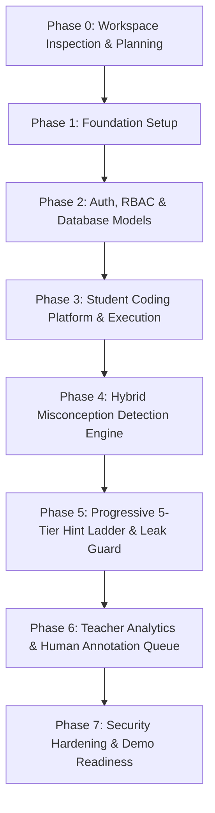

# CodeRazz — Implementation Roadmap & Execution Checklist

> **Target Budget:** ₹0  
> **Development Methodology:** Milestone-driven, incremental verification, test-first validation.

---

## Roadmap Overview

---

## Detailed Phase Breakdown & Task Checklists

### Phase 0: Workspace Inspection & Planning (Current Phase)
- [x] Inspect local machine development tools (Python 3.12, Node v25, npm 11, Docker, Git).
- [x] Check runtime services (Docker Desktop status, Ollama client status).
- [x] Establish project engineering protocols in `AGENTS.md`.
- [x] Document comprehensive system architecture in `docs/ARCHITECTURE.md`.
- [x] Document Architectural Decision Records in `docs/DECISIONS.md`.
- [x] Define testing and verification strategy in `docs/TESTING.md`.
- [x] Author project implementation plan with checklists in `docs/IMPLEMENTATION_PLAN.md`.
- [x] Prepare `.env.example`, `.gitignore`, and top-level `docker-compose.yml` outline.
- [x] Present Phase 0 architecture to user for review and approval.

---

### Phase 1: Foundation Setup
- [x] **Repository Structure Setup:**
  - Create monorepo directories: `frontend/`, `backend/`, `execution/`, `ml/`, `dataset/`, `scripts/`, `tests/`.
- [x] **Backend Initialization:**
  - Initialize Python virtual environment with standard `venv`.
  - Install FastAPI, Uvicorn, SQLAlchemy 2, Alembic, Pydantic v2, Pytest, Ruff.
  - Setup modular application factory in `backend/app/main.py`.
  - Implement `/health` and `/api/v1/ping` endpoints.
- [x] **Database & Docker Configuration:**
  - Create `docker-compose.yml` with PostgreSQL 16 service, health checks, and persistent volumes.
  - Configure database connection manager: PostgreSQL 16 as primary target with automatic SQLite development fallback when Docker is offline.
  - Configure Alembic migration environment (base setup, without premature domain tables).
- [x] **Frontend Initialization:**
  - Initialize Next.js App Router application with TypeScript and Tailwind CSS, standardized on Node.js 22 LTS.
  - Configure Tailwind styling, theme tokens, and typography.
  - Setup API client utility with typed fetch wrappers and error handling.
- [x] **Verification:**
  - Execute backend unit tests via Pytest (5 passing unit tests).
  - Run frontend build / type-check (0 TypeScript errors, successful Next.js 15 build).
  - Verify health check endpoints respond with `200 OK` on live HTTP requests.

---

### Phase 2: Authentication, RBAC & Database Schema
- [x] **Database Models & Migrations:**
  - Implement SQLAlchemy models: `User` (with roles: `STUDENT`, `TEACHER`, `ANNOTATOR`, `ADMIN`), and `RefreshToken` (with SHA-256 hash and revocation flag).
  - Generate and apply Alembic migration (`c7aea71fa178_create_users_and_refresh_tokens_tables.py`) to PostgreSQL 16 on port 5433.
- [x] **Authentication & Security:**
  - Argon2id password hashing and verification using `argon2-cffi`.
  - JWT access token generation and verification with HMAC-SHA256.
  - Rotating refresh tokens with SHA-256 hash storage and database-backed revocation.
  - Implement role-based dependency guards (`get_current_user`, `require_role(*roles)`).
  - Privilege escalation protection (disallowing self-assigned ADMIN/ANNOTATOR during registration).
  - Seed initial administrator via offline CLI script (`scripts/create_admin.py`).
- [x] **Auth API Endpoints:**
  - `POST /api/v1/auth/register` (student / teacher signup with validation).
  - `POST /api/v1/auth/login` (returns JWT + rotating refresh token + user profile).
  - `POST /api/v1/auth/refresh` (rotates refresh token and issues new JWT pair).
  - `POST /api/v1/auth/logout` (revokes active refresh token in database).
  - `GET /api/v1/auth/me` (active session profile verification).
  - `GET /api/v1/auth/role-test/{role}` (RBAC verification probes for student, teacher, annotator, admin).
  - `PUT /api/v1/auth/users/{user_id}/role` (admin-only user role management).
- [x] **Frontend Auth UI:**
  - Modern sign-in page (`/login`) with form validation and demo test accounts.
  - Registration page (`/register`) with role cards, password complexity checks, and privilege boundaries.
  - Authenticated dashboard (`/dashboard`) displaying user profile, active RBAC permissions, and interactive live backend RBAC probes.
  - Dynamic auth-aware navigation header (`Navbar.tsx`) with login/register links or user avatar, role badge, and logout trigger.
- [x] **Verification:**
  - Unit tests for Argon2 password hashing, JWT generation/expiry/tamper resistance, and token hashing (6 tests passing).
  - Integration tests for auth endpoints, registration, duplicate checks, login, refresh rotation, revocation, RBAC matrix, and admin role updates (8 tests passing).
  - Total 25 backend tests passing against live PostgreSQL 16 container.
  - Zero Ruff linting errors (`All checks passed!`).
  - Next.js 15 production build and typecheck with Node 22 LTS passing (`0 errors`).

---

### Phase 3: Student Coding Platform & Execution Sandbox
- [x] **Problem Library Management:**
  - Seed initial starter catalog of classic introductory programming problems (`two-sum`, `reverse-string`, `count-vowels`, `fizz-buzz`, `valid-palindrome`) with sample & confidential hidden test cases.
  - Problem catalog view (`/problems`) with difficulty filters (`EASY`, `MEDIUM`, `HARD`), search input, and challenge cards.
  - Problem detail workspace (`/problems/[id]`) with Markdown problem description, constraints, I/O examples, and sample test cases drawer.
- [x] **Monaco Code Editor Integration:**
  - Embed Monaco Editor in Next.js workspace (`@monaco-editor/react`) with Python syntax highlighting, code folding, auto-indentation, and dark/light themes.
  - Interactive "Run Code" button for sample test cases / custom input and "Submit Solution" for full grading.
  - Split-pane layout with resizable/responsive challenge viewer, code editor, and interactive output console / terminal.
  - Code reset to starter template, sample test case drawer, and submission history viewer.
- [x] **Sandboxed Code Runner:**
  - Build minimal Alpine Linux runner container image (`coderazz-python-runner:latest`, 18.1 MB).
  - Implement `backend/app/services/sandbox.py` orchestrator enforcing disposable ephemeral containers: non-root (`uid=10001:10001`), `--network none`, `--read-only`, tmpfs (`16m,noexec,nosuid`), `--cap-drop=ALL`, `--security-opt=no-new-privileges`, hard CPU limit (1.0), memory limit (128 MB), process ceiling (`--pids-limit 32`), and zero secret/socket mounting.
  - Dual timeout watchdog (3.0s wall-clock) with immediate SIGKILL and container pruning.
  - Runaway stdout/stderr output truncation capped at 64 KB ceiling with overflow truncation notices.
  - Docker-unavailable security guard: returns HTTP 503, strictly rejecting silent bare host execution.
- [x] **Submission Processing Pipeline & APIs:**
  - `POST /api/v1/submissions/run` endpoint for interactive testing against sample test cases or custom input.
  - `POST /api/v1/submissions` endpoint for grading against hidden test cases with competitive programming standards (stop on first failure).
  - `GET /api/v1/submissions` endpoint for student submission history listing.
  - `GET /api/v1/submissions/{id}` endpoint with strict cross-student RBAC access isolation (students cannot view peers' submissions).
  - `GET /api/v1/problems` and `GET /api/v1/problems/{id_or_slug}` with confidential hidden test case masking.
  - `POST /api/v1/problems` admin/teacher endpoint for problem creation.
- [x] **Verification & Hostile Code Testing:**
  - 6 Problem Catalog integration tests passing.
  - 13 Sandbox Execution integration tests passing (including real Docker sandbox execution against infinite loops, fork bombs, memory exhaustion, network severance, read-only filesystem writes, output flooding, and container orphan checks).
  - 45 total project tests passing in 5 minutes with zero failures.
  - Frontend production build and typecheck passing with Node 22 LTS.
  - 0 Ruff linting errors across codebase.

---

### Phase 4: Hybrid Misconception Detection Engine
- [x] **Taxonomy Formalization:**
  - SQLAlchemy models for `MisconceptionTaxonomy` and `Diagnosis` with `DetectorType` enum.
  - Seed database with all 30 authoritative core taxonomy classes (`A1` through `G3`) plus `S1` (slip) and `S2` (novel) totaling 32 classes.
  - Idempotent seeder verified against PostgreSQL 16 on port 5433 and SQLite fallback.
  - Alembic migration `f61a2e16bbd5_create_misconception_taxonomy_and_.py` applied.
- [x] **AST Analysis Engine (`ml/ast_analyzer.py`):**
  - Implement AST visitor strictly extracting decoupled structural facts (loop boundaries, condition mutations, return positions, uninitialized reads, mutable default parameters, and subscripts).
- [x] **Top-10 Core Rule Detectors (`ml/rule_detectors.py`):**
  - High-precision, zero-false-positive deterministic detectors for:
    - `A1`: Off-by-one in loop bounds.
    - `A2`: Infinite loop condition.
    - `A3`: Index out of range.
    - `A5`: Premature loop termination (`return`/`break` inside loop body).
    - `B1`: Assignment in condition.
    - `B2`: Inverted boolean operators.
    - `C1`: Uninitialized variable usage.
    - `D2`: Missing explicit return in fruitful function.
    - `D4`: Return placed inside loop accumulator.
    - `G1`: Confusing `print()` with `return`.
    - `S1`: Syntax error precedence rule (confidence 1.0).
- [x] **Diagnostic Probe Generator (`ml/prober.py`):**
  - Generate micro-test boundary probes (`empty_input`, `single_element`, `duplicate_elements`, `zero_boundary`, `negative_value`) to isolate ambiguous failures.
  - Executed inside isolated Docker runner container enforcing `--pids-limit 32`, 128 MB RAM, and 1.5s timeout.
- [x] **Scikit-learn Baseline Classifier (`ml/classifier.py`):**
  - Feature extraction pipeline combining AST node distributions and token n-gram TF-IDF.
  - Trained lightweight `LogisticRegression` pipeline with probability calibration across taxonomy classes.
- [x] **Multi-Source Fusion Engine (`ml/fusion.py`):**
  - Priority hierarchy:
    1. S1 Syntax Error Precedence (1.0 confidence)
    2. AST Deterministic Rules (confidence >= 0.90)
    3. Sandbox Micro-Probes (confidence >= 0.90)
    4. Statistical ML Classifier (confidence >= 0.40)
    5. S2 Novel / Unclassified fallback (0.30 confidence)
- [x] **API & UI Integration:**
  - `POST /api/v1/submissions` diagnoses non-accepted submissions and persists `Diagnosis` records in PostgreSQL.
  - `POST /api/v1/submissions/run` returns diagnosis on interactive run failure.
  - `GET /api/v1/submissions/{id}` returns eager-loaded diagnoses.
  - Monaco editor line decorations highlighting faulty `evidence_lines` with click-to-jump.
  - Responsive Misconception Diagnosis card displaying taxonomy badge, confidence score, detector type, diagnostic explanation, and pedagogical remedy guidance.
- [x] **Verification:**
  - 48 unit tests passing (covering AST analysis, rule detectors, prober, classifier, fusion, config, and security).
  - 17 integration tests passing (including end-to-end diagnosis API submission tests and real Docker execution).
  - 0 Ruff linting errors across codebase.
  - Frontend typecheck and Next.js 15 production build passing with 0 errors.

---

### Phase 5: Progressive 5-Tier Hint Ladder & SolutionLeakGuard
- [ ] **Template Engine:**
  - Curate high-quality, pedagogically verified templates for all 5 levels for the 27 taxonomy classes.
- [ ] **SolutionLeakGuard Engine (`ml/leak_guard.py`):**
  - Token n-gram overlap analyzer between hint text and reference solution.
  - AST subtree similarity checker.
  - Regex pattern matcher preventing direct code block leaks.
- [ ] **Hint Service Endpoints:**
  - `GET /api/v1/hints/submission/{id}`: View unlocked hints.
  - `POST /api/v1/hints/request`: Unlock next progressive hint level (Level 1 through Level 5).
  - `POST /api/v1/hints/{id}/feedback`: Helpful / not helpful rating.
- [ ] **Optional Local Ollama LLM Adapter:**
  - Configurable adapter to call local Ollama endpoint (`http://localhost:11434`) when enabled, passing output through `SolutionLeakGuard`.
- [ ] **Frontend Hint Component:**
  - Progressive disclosure accordion, hint level indicators, and helpfulness feedback buttons.

---

### Phase 6: Teacher Analytics & Human Annotation Queue
- [ ] **Class Management:**
  - Teacher class creation, roster management, and join code generation.
  - Student class enrollment via join code.
- [ ] **Class-Wide Misconception Analytics:**
  - Aggregate statistics calculating misconception prevalence across students and assignments.
  - Problem-by-misconception interactive heatmap using Recharts.
  - Longitudinal trend charts showing misconception decay/persistence over time.
- [ ] **Individual Student Diagnostic Profile:**
  - Visual timeline of student misconceptions, mastery badges, and persistent struggle areas.
- [ ] **Human-in-the-Loop Annotation Queue:**
  - Review dashboard for annotators and teachers to inspect submissions flagged as low-confidence or `S2`.
  - Override interface to correct automated diagnoses, retraining data export in CSV/JSON format.

---

### Phase 7: System Hardening, Stress Testing & Demonstration
- [ ] **Security Hardening:**
  - Verify container rlimits and security profiles under stress.
  - Submit adversarial code payloads (fork bombs, system file reads, socket connections) and verify sandbox containment.
- [ ] **End-to-End Verification:**
  - Automated Playwright browser tests covering full student submission -> diagnosis -> hint progression -> teacher heatmap.
- [ ] **Documentation & Setup Scripts:**
  - Comprehensive `README.md` with zero-to-running local instructions.
  - `scripts/seed_demo_data.py` to seed sample classes, students, problems, and analytics for live demonstration.
