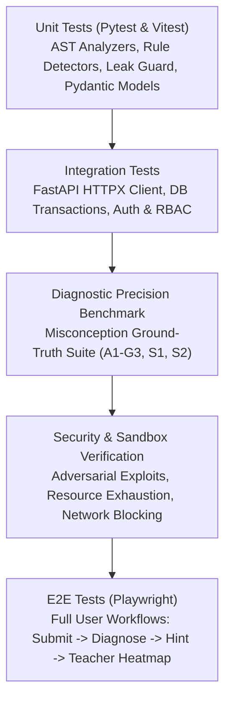

# CodeRazz — Testing Strategy & Verification Protocols

This document defines the automated and manual testing standards required to guarantee system correctness, pedagogical diagnostic precision, and execution security.

---

## 1. Testing Pyramid Overview



---

## 2. Test Suites by Layer

### 2.1 Backend Unit Tests (`tests/unit/`)
- **Pydantic Validation:** Strict payload validation for invalid inputs, missing fields, and type coercion.
- **JWT & Password Security:** Password hashing rounds, token expiration, tamper-resistance, and role permission dependencies.
- **AST Feature Extractor:** Parsing canonical Python AST nodes and verifying extracted structural metrics (nesting depth, loop count, return positions).
- **SolutionLeakGuard Tests:** Asserting that hints containing code tokens matching reference solution AST are strictly blocked and flagged.

### 2.2 Misconception Diagnostic Benchmark (`tests/diagnostic/`)
We maintain a curated ground-truth dataset in `dataset/benchmarks/`:
- **Synthetic Buggy Programs:** Handcrafted minimalist Python functions illustrating each of the 30 core misconceptions (`A1`–`G3`) and meta-classes.
- **Detector Accuracy Assertions:**
  - Precision target: $\ge 85\%$ on deterministic rule-detectable classes (`A1`, `A2`, `A5`, `B1`, `C1`, `D2`, `D4`, `G1`).
  - Graceful degradation: Submissions that do not match known patterns must be categorized with low confidence or assigned to `S2` rather than yielding false positives.
  - Line Evidence Verification: Check that the reported `line_number` in `DiagnosisEvidence` matches the exact fault location.

### 2.3 Sandboxed Execution Security Tests (`tests/security/`)
Before any public submission is accepted, the sandbox is evaluated against an adversarial exploit test battery:

| Test ID | Adversarial Payload | Expected Behavior |
|---|---|---|
| `SEC-001` | **Infinite Loop:** `while True: pass` | Terminated strictly within 3.0s wall-clock time with `TIME_LIMIT_EXCEEDED`. |
| `SEC-002` | **Memory Bomb:** `x = [0] * (10**8)` | Terminated by cgroups/rlimit ceiling (128MB) with `RUNTIME_ERROR` (OOM). |
| `SEC-003` | **Fork Bomb:** `while True: os.fork()` | Prevented by PID limits (max 32 processes) or blocked by sandbox security profile. |
| `SEC-004` | **File System Tampering:** `open('/etc/passwd', 'r').read()` | Blocked by read-only filesystem or restricted permissions; cannot escape sandbox. |
| `SEC-005` | **Network Egress:** `urllib.request.urlopen('http://example.com')` | Immediately fails with socket connection refused due to `--network none`. |
| `SEC-006` | **Output Flooding:** `while True: print("A" * 1000)` | Output truncated at 64KB ceiling; process killed to prevent disk bloat. |

### 2.4 Integration Tests (`tests/integration/`)
- API endpoints tested using FastAPI's `TestClient` and `httpx.AsyncClient`.
- Database transaction isolation: Each test runs inside a rollback transaction or isolated SQLite/Postgres test database.
- RBAC permissions: Ensuring students cannot call teacher analytics or annotator queues.

### 2.5 End-to-End Tests (`frontend/e2e/` via Playwright)
- Student logs in, navigates to Problem Library, selects "Sum of Digits".
- Student types buggy code in Monaco Editor with an off-by-one loop error (`A1`).
- Student clicks "Run & Submit".
- UI renders test-case failures and the diagnosed misconception badge: *"Off-by-one in loop bounds (A1)"*.
- Student clicks "Request Hint", receiving Level 1 Nudge.
- Student clicks "Request Next Hint", unlocking Level 2 Conceptual Hint.
- Teacher logs in, views Class Heatmap, verifying the recorded `A1` misconception increment.

---

## 3. Test Execution Commands & Tools

- **Backend Pytest:**
  ```bash
  pytest -v --cov=backend/app --cov-report=term-missing
  ```
- **Ruff Code Formatting & Linting:**
  ```bash
  ruff check backend ml execution
  ruff format --check backend ml execution
  ```
- **Frontend Typecheck & Tests:**
  ```bash
  npm run typecheck
  npm run test
  ```
- **Playwright E2E Suite:**
  ```bash
  npx playwright test
  ```
